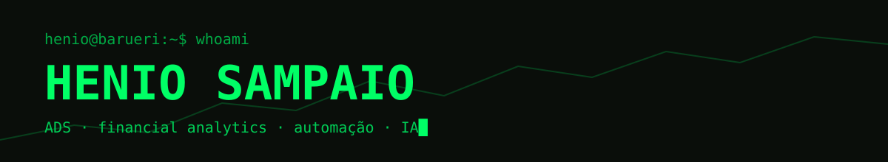

<p align="center"></p>

```text
$ cat sobre.txt
nome ....... Henio Sampaio (HBS)
local ...... Barueri, São Paulo
foco ....... Análise e Desenvolvimento de Sistemas & Financial analytics
constrói ... apps desktop em Python, automação, IA e trading quantitativo
```

### ▌ Stack

<p>


</p>

### ▌ Projetos

| Projeto | O que é |
|---|---|
| [**Trama**](https://github.com/HenioSampaio/trama-versoes) | Orquestrador visual "nó para tudo": fluxos de dados, conciliação, IA e vídeo. |
| [**Memecoin Lab**](https://github.com/HenioSampaio/memecoin-lab-versoes) | Laboratório de copy-trade de memecoins na Solana, testando em papel antes de arriscar. |
| **TradeGrok** | Mesa de trading com IA: traders e agentes que debatem e votam por consenso (privado). |
| [**Carteiro SBW**](https://github.com/HenioSampaio/carteiro-sbw-versoes) | Automação de envio de notas fiscais e notas de débito. |

<p>
<a href="https://github.com/HenioSampaio/trama-versoes"></a>
<a href="https://github.com/HenioSampaio/memecoin-lab-versoes"></a>
</p>

### ▌ Stats

<p>


</p>
<p></p>

<p align="center"><sub>// build · test in paper · ship</sub></p>
